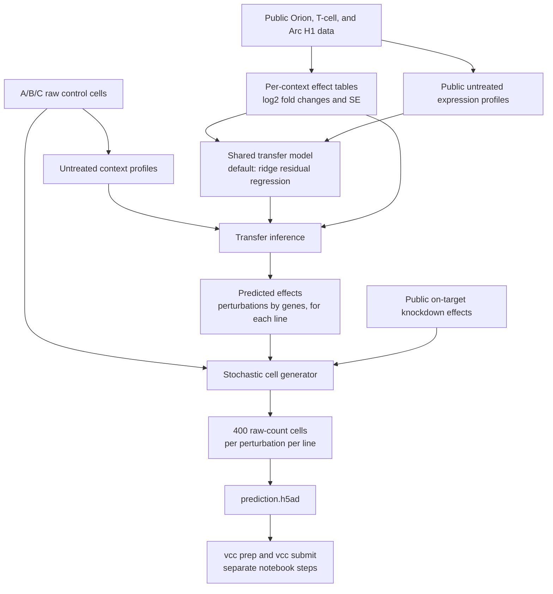
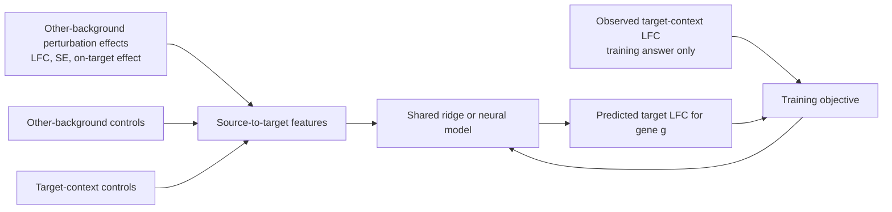
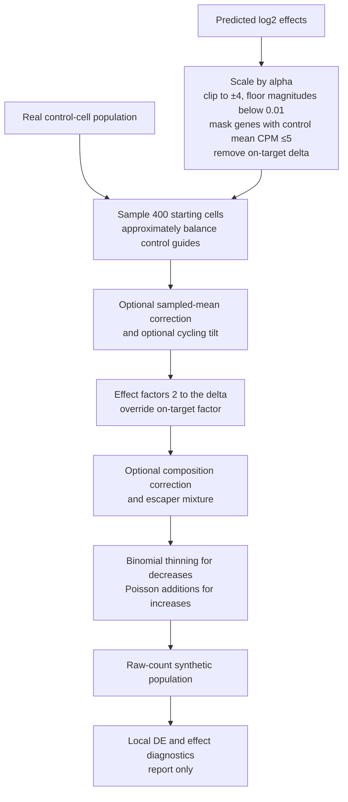

# Post-review implementation — 8 October 2026

The current [notebook](vcc_2026.ipynb) implements the attached engineering review. The earlier methodology is preserved below as an **archived pre-change review**; its defaults and interface findings describe the old implementation.

## Current workflow and required inputs

The notebook remains the source of truth: its five `%%writefile` cells contain the implementation. New artifacts go into `lib/review_v4` and checkpoints from older revisions must be retrained. Supply the existing Orion/T-cell inputs, **full public 2025 H1 raw cells**, the A/B/C control bundle, and the shared gene/target CSVs. The old H1 oracle subset is no longer the primary evaluation input. No biological input files are present in this workspace.

Provide a Replogle manifest at `lib/replogle/manifest.csv`. Required columns are `cells,name,background,obs_col,control`; optional columns are `guide_col,gene_col,layer,platform,kind,priority,target_split`. Paths point to raw-cell h5ad files; controls use exact source labels, separated by commas if needed. Both K562 releases use biological background `K562`; RPE1 uses `RPE1`. Verified original raw-cell download links are in the notebook. Later releases can be added through the same explicit manifest; their labels and provenance must be checked. Tahoe is not a transfer source.

Provide `lib/functional_neighbours.csv` with `gene_a,gene_b,score` for positive co-essentiality/STRING similarities or CORUM-complex edges. For entirely uncovered targets, each source borrows the top five available covered neighbours by similarity and combines their effects. Borrowing is used only when there is no direct source evidence. Each neighbour's own knockdown column is masked before averaging, because it is not a downstream effect of the borrowed target and that gene is scored for it. Borrowed uncertainty includes between-neighbour disagreement; missing donor SE remains missing. Prediction reports record each borrowed target and its donors. Without evidence, prediction fails with an actionable coverage report; `--allow-unsupported` is an explicit, documented zero-fallback override.

Coverage reports run before Replogle ingestion, after ingestion, and after A/B/C profiling. They give direct coverage, coverage after borrowing, unresolved targets and per-source counts. The target list is shared across challenge contexts; per-line reports additionally show whether target transcripts were measured. Numerical coverage cannot be reported until the real tables are supplied.

## Statistical changes

- Shared producers and consumers now agree on canonical `pooled_cpm`, with a compatible `bulk_cpm` alias. Program callers use `(cpm, genes)` and receive program names plus numeric levels. The download cell has `%%bash`. Raw counts and every generated row are validated.
- Source effects use a context-level normal prior: `prior_variance = max(var(LFC) - mean(SE²), 0.01)` over entries with usable SE; posterior mean is `LFC * prior_variance / (prior_variance + SE²)`. The variance is cached per context and remains constant across prediction chunks. `SE <= 1e-6` and nonfinite SE use the same missing-SE convention in shrinkage and label weighting. Missing source SE keeps the conservative 0.5 multiplier.
- Guide QC checks every eligible row before duplicate selection. Measured on-target LFC must be below -0.1; failed rows are dropped, then the largest successful group is selected. Missing on-target measurements are retained and identified in `guide_qc.csv`. These checks do not create replicate-level uncertainty: SE remains cell-level where guide/batch replicate statistics are unavailable.
- Training samples output genes uniformly, including low-baseline genes; no unweighted source-signal enrichment remains. Existing background-balanced precision weights are retained. Two CD4_T states share one background's training mass.
- Source means use softmax weights of control-transcriptome correlation. Nonlinear features multiply effects by knocked-down-gene basal-expression/detection gates and an asymmetric output-gene gate. A measured off target has zero gate; missing expression/detection passes through. The whole ridge residual path, including its intercept feature, is gated by target expression/detection as well. Downregulation is suppressed at low responder expression; source-supported induction is retained. Temperature and gate center are selected on LOBO, with fixed gate widths.
- Each source table has one bounded global effect scale, estimated from other **training** backgrounds and regularized toward 1. Target backgrounds contribute equal moment weights. These scales, source priors, generic signatures, feature scaling and ridge weights are recomputed inside folds.
- Inner validation is biological LOBO only; the old perturbation split and inner target reserve are removed. Outer H1/background fits exclude that background before opening its effect/profile files. After selection, all eligible training targets are refit. Source mean stays selected unless ridge wins at least three original background folds and at least 75% of those available. Additional Replogle folds contribute diagnostics and tuning; they do not bypass the original-background win rule. Four original backgrounds still provide only four independent context contrasts.

## Generator and validation

Predictions are projected onto valid composition before raw-count generation: form all-gene factors `f = 2**delta`, include the source-derived on-target factor, then normalize by `sum(share * f)`. There is no small-LFC floor or changed-gene-only correction. Zero-baseline induction has an explicit 0.5-CPM pseudocount path. The generator reports the projection normalizer and projected planned effects.

Projection necessarily changes unconstrained predictions: the expected pooled-CPM effect for a measured gene is `delta - log2(normalizer)`, rather than exactly `delta`. It cannot guarantee unchanged CPM for every untouched gene, nor can it equate pooled and per-cell means when libraries vary. The official H1 comparison is needed to assess the resulting cells.

Library depth is an independent whole-cell scale, with optional `median_umi_per_cell` metadata. The UMI setting controls expected depth; the stochastic realized median is reported. Downregulation uses binomial thinning. Upregulation blends each cell's observed counts with its library-scaled expected counts (default `up_w=0.75`) and uses gamma-Poisson additions with control-derived overdispersion; induced genes with no observed control counts use a dispersion fallback. Escaper fraction is capped per perturbation at the smallest feasible factor, preventing attenuation from an infeasible mixture floor.

The same base control pool is used across perturbations within each context. Stable SHA-256 seeds identify context, target and gene; per-gene count streams are shared between perturbations. Target-order changes no longer advance a shared stream. Contexts retain separate streams. Optional cycling tilt can change the selected pool. All output rows are scanned for finite nonnegative integer counts, dimensions, per-cell count caps and submission storage/cell caps.

The H1 benchmark uses the H1-excluded fold's transfer predictions, compares ridge and source mean with the official evaluator and its ceiling, and scans global `alpha`, `pi` and `up_w`. Generator settings are selected for the transfer method accepted by the multi-background decision. H1 controls are split between generator input and reference scoring; all eligible H1 perturbation cells are used as reference. A separate oracle estimates effects from half the perturbation cells and scores on the other half; it never chooses submission settings. The oracle remains an approximate generator-only diagnostic, not an upper bound on the full model or evidence of unseen-context performance.

## Current rules versus assumptions in the review

Verified against the [official submission guide](https://vcc-cli-wiki.virtualcellchallenge.org/) and [official metric specification](https://github.com/ArcInstitute/cell-eval2/blob/main/docs/vcc2026_metrics/vcc2026-metrics.md): 2026 submissions require **400 cells per perturbation per context**. Optional `n_cells` metadata is parsed but must match that contract; changing cell count remains a local benchmark experiment. The current target CSV is a bare shared list, so the notebook's fallback remains 400. The generator enforces the exact common panel across contexts. The tested official CPU versions are pinned in [requirements-eval.txt](requirements-eval.txt).

Scoring uses **`cell-eval2 --preset vcc2026 --profile vcc2026`**, not the older `cell-eval` default. The official DE estimator is arithmetic mean per-cell CPM with epsilon 1e-9. Raw H1/Replogle builders use the same per-cell CPM estimator on the provided gene axis, but modelling labels add a 0.5 CPM pseudocount instead of 1e-9. With 1e-9, a zero-count group on an unscored low-count gene yields an LFC near -30 with a small delta-method SE, which defeats shrinkage and leaks into lines where that gene is expressed. Above the 5-CPM scoring gate the pseudocount moves an LFC by at most about 0.13. Aggregate Orion CPM sums cannot reconstruct a different original normalization denominator; their estimator is therefore marked approximate. Precomputed T-cell effects retain their upstream convention. The target transcript is excluded from all six metrics, and all panel targets are excluded from discrimination. Baseline-silent induction is not counted by the official DE filter, although it affects expression metrics.

The benchmark selects using average rank across exactly six raw official metrics with their verified directions. This is a local robustness heuristic: the live leaderboard uses measured baseline/replicate reference scaling and averages the six scaled metrics. No leaderboard equivalence is claimed. The evaluator's preset handles gene exclusions and reference-control conventions; custom MWU/Jaccard/retrieval proxies have been removed. Each run records its command and installed package versions. Submission and remote backup remain explicit notebook cells and were not executed during this revision.

## Validation status

**Final check: 18 tests passed**, including the actual official CPU benchmark and ceiling integration. Notebook JSON/IPython syntax, static Bash command syntax, script interfaces and the working-tree whitespace check also passed. No original cell IDs or execution outputs were changed.

[Regression tests](tests/test_notebook_pipeline.py) extract the five scripts directly from the notebook. They cover profile alignment/program interfaces, prior shrinkage and invalid SE, failed-guide selection, composition and induction, escaper feasibility, metadata and submission generation, late-row invalid counts, target-order/common-draw reproducibility, nested holdout isolation, neighbour fallback, official result parsing and Bash/Python/notebook validity. Run with `python -m pytest tests/test_notebook_pipeline.py -q` after installing [test dependencies](requirements-test.txt).

The actual official `cell-eval2 0.18.0` / `pdex 0.3.0` CPU integration test also runs a synthetic H1 benchmark, produces both model/source-mean metric and ceiling files, parses all six metrics and writes the settings selection. It skips when the official evaluator is not installed.

Real-data coverage, training, H1 calibration and biological scoring have not been run: the workspace lacks those datasets and the functional graph. Validation results and the synthetic official-evaluator smoke test are reported in the final engineering check; they do not establish biological quality or leaderboard performance.

---

# Archived pre-change methodology

# VCC v3 methodology and final code check

Source: [vcc_2026.ipynb](vcc_2026.ipynb), reviewed on 8 October 2026. This document records the current implementation, its intended workflow, assumptions, and tunable settings. It does not propose changes or modify the notebook.

**Status:** this is a source review, not evidence of a completed experiment. All notebook execution counts are null and there are no saved outputs. The local `code/`, `data/`, and `results/` folders and public-data subfolders contain no implementation or data files. The embedded Python scripts pass syntax parsing, but the local virtual environment lacks their scientific dependencies. Training, generation, the H1 oracle, and the official evaluator were not run. There are interface inconsistencies that prevent the supplied notebook from completing as written; these are recorded at the end.

## 1. What the two stages do

1. **Transfer model:** learn a shared relationship between public perturbation effects and differences in untreated expression context, using Orion, T-cell, and **Arc H1 data in transfer training**. For a new line A/B/C, use that line's controls and the retained public perturbation tables to predict a log2 fold change for every requested perturbation–gene combination. The notebook selects ridge regression; a neural mixture is available but not selected.
2. **Cell generator:** take the predicted effects, source-derived knockdown efficiency, and actual control cells from A/B/C. Sample and edit those cells to produce **400 cells per perturbation per line**. This is a stochastic count simulator, with no learned weights or backward pass. H1 provides an oracle experiment for comparing generator settings.

The transfer output is an **effect table**, not a population of predicted control cells. The generator produces the cell population. With `T` perturbations, `G` genes, and three lines, the submission has `3 × T × 400` rows and `G` columns.



“Based solely on initial context” applies to **new-line measurements**: A/B/C perturbation answers are not supplied. Inference also requires public effects for the requested perturbation. If no public source contains it, the transfer code writes zero effects. There is no implemented mechanism to infer an entirely unsupported perturbation from its name or protein structure.

## 2. Input data and how quantities are derived

### 2.1 Data actually wired into the notebook

| Input | Use | Representation consumed |
|---|---|---|
| Orion HCT116 and HEK293T pseudobulk files | Public transfer sources and training target contexts; generator on-target efficiency | Per-perturbation sufficient statistics: `sum_counts`, `sum_cpm`, `sum_cpm2`, `n_expr`, and `n_cells` |
| T-cell Stim48hr and Rest effect tables | Public transfer sources and training target contexts | `X` containing precomputed LFC, `layers/se`, `var/ctrl_cpm`; gene and perturbation labels |
| Arc H1 pseudobulk file | Public transfer source and training target context; H1 holdout evaluation in its separate excluded-background fold | Same sufficient-statistic format as Orion |
| H1 oracle raw-cell file | Generator calibration/variant comparison | Real control and perturbed single-cell counts, labeled by target |
| `context_A.h5ad`, `context_B.h5ad`, `context_C.h5ad` | New-line profiles and generator starting cells | Raw single-cell counts in `X`, aligned by gene name |
| `gene_names.csv` | Common output gene axis | `gene_name` column |
| `pert_counts.csv` | Requested target order | `target_gene` column; the generator uses the fixed `--n-cells`, rather than any per-target count column |
| `tcell_targets_effects.h5ad` | Generator on-target efficiency | Target effects, filtered to Stim48hr by default |

Replogle and Tahoe are named in the overview but are not loaded by any current pipeline command. Protein folds, protein embeddings, sequence features, pretrained gene embeddings, and SVD embeddings are not model inputs. Gene names align the data and locate the knocked-down transcript; they are not learned categorical embeddings.

The overview's claims of 18,400 controls and an H1 oracle file containing 120 knockdowns with up to 300 cells each describe the expected files. Their contents are unavailable locally, so those counts cannot be verified. The code uses actual available controls, not a hard-coded 18,400.

### 2.2 Control-cell profiles

Let `x_ig` be raw counts for cell `i`, gene `g`, and `L_i = sum_g x_ig`. The denominator is the aligned provided gene axis, not necessarily every gene in the original experiment.

```text
per-cell CPM_ig = 1,000,000 × x_ig / max(L_i, 1)
mean_cpm_g     = mean_i(CPM_ig)
pooled_cpm_g   = 1,000,000 × sum_i(x_ig) / max(sum_i L_i, 1)
var_cpm_g      = max(mean_i(CPM_ig²) − mean_cpm_g², 0)
se_mean_g      = sqrt(var_cpm_g / n_cells)
detection_g   = fraction of cells with x_ig > 0
```

`var_cpm` uses the population moment convention, not the unbiased `n−1` sample variance. `se_mean` measures uncertainty in a mean; it is different from the spread of individual cells.

The intended default transfer baseline is `log1p(pooled_cpm)` (natural logarithm). The generator's expression gate uses the arithmetic per-cell `mean_cpm > 5`. These two CPM estimators can differ when library sizes vary. LFC labels and generator effects are in **log base 2**; context features use **natural-log `log1p`**.

Profiles also retain measured-gene flags, cell count, and, for raw-cell profiles, median library size. Named programs summarize cell cycle S and G2M, stress, interferon, hypoxia/glycolysis, biogenesis, ribosomes, and mitochondrial genes. The common helper computes the average `log1p(pooled_cpm)` across each program's finite measured genes, requiring at least three. These program features are intended to be optional transfer inputs and are disabled by default. The generator separately uses a cell-cycle score for its optional tilt.

The challenge profiling command uses `--all-controls`: no 20,000-cell subsampling cap applies. If `target_gene` exists, only `non-targeting` cells are selected. If the observation column is absent, every row is assumed to be a control. Missing genes are retained as NaN in profiles/effect tables; the generator pads missing genes with zero counts.

### 2.3 Public perturbation labels and standard errors

**Orion/H1:** perturbation rows with at least 20 cells are eligible. For repeated target names, the row with the most cells is retained; guides are not combined at this stage. For perturbation `k`:

```text
LFC_kg = log2((pooled_CPM_kg + 0.5) / (pooled_CPM_control,g + 0.5))

SE_kg ≈ sqrt(
    var_per_cell_CPM_kg / [n_k × (mean_per_cell_CPM_kg + 0.5)²]
  + var_per_cell_CPM_control,g / [n_control × (mean_per_cell_CPM_control,g + 0.5)²]
) / ln(2)
```

This is the code's delta-method approximation. The **label uses pooled CPM, while its SE is derived from per-cell CPM means and variance**. They are not exactly the same estimator. The metadata explicitly describes this as cell-level SE that can be overconfident relative to replicate-level SE. It does not capture independent biological-replicate variation or shared batch effects.

**T cells:** the script copies supplied LFC and SE arrays. Its metadata describes the upstream values as replicate-paired pseudobulk LFC and donor-level, limma-style moderated SE. The upstream builder is absent, so this review cannot verify that derivation, its pseudocount, replicate count, or moderation settings. `ctrl_cpm` is copied into both `mean_cpm` and `pooled_cpm`; per-cell detection, variance, and mean SE remain unknown. Consequently the per-cell scoring gate is only an approximation for this baseline.

Effects and SE are saved as float16 arrays, with gene/target names and provenance metadata. Missing measurements remain NaN. Tables explicitly marked legacy are rejected unless `--allow-legacy-effects` is provided; this flag does not establish the provenance of a baseline estimator. Known-SE tables may still contain individual missing SE values.

## 3. Model 1 — context-conditioned transfer

### 3.1 Training observation and “answer”

One training row is `(target public context, knocked-down gene k, output gene g)`. The answer is the **observed, unshrunk target-context LFC_kg** from its public effect table. It is not a cell count, protein fold, SE, or Wilcoxon p-value.

The same model is shared across all training contexts. The code does not train a separate independent model per cell line. It turns contexts around as supervised targets, using other biological backgrounds as sources. This is pairwise context conditioning with pooling across available sources; it can use more than one source simultaneously.



The feature builder has no target-outcome argument. The target perturbation's measured effects are accessed separately to supply labels, not input features. The source's own on-target LFC is an allowed input; the target context's on-target LFC is not an input.

### 3.2 Exact features supplied

For each valid public source and output gene, `features()` produces 22 source features: 14 scalar features plus eight program differences.

| Source feature | Derivation / interpretation |
|---|---|
| `source_lfc` | Source's measured LFC for this perturbation and output gene, clipped to ±8 |
| `source_se` | Supplied/derived LFC SE, clipped to [0, 8]; NaN replaced by zero with a separate flag |
| `se_missing` | Whether SE is nonfinite |
| `source_shrunk_lfc` | Signal-to-noise-shrunk source effect, formula below |
| `source_baseline` | Untreated source `log1p` baseline for output gene |
| `baseline_difference` | Untreated target baseline minus source baseline for output gene |
| `source_knockdown_gene_baseline` | Untreated source baseline of knocked-down gene |
| `knockdown_gene_baseline_difference` | Target minus source untreated baseline of knocked-down gene |
| `source_ontarget_lfc` | Measured source effect on knocked-down transcript itself, clipped to ±8 |
| `ontarget_missing` | Whether that on-target effect is unavailable |
| `legacy_effect` | Source table legacy flag |
| `context_pearson` | Centered correlation between finite source/target baseline-log vectors; **zero by default** |
| `agreement` | Fraction of other valid sources with shrunk effect magnitude >0.05 that agree in sign; fallback 0.5 if none |
| `legacy_source_baseline` | Baseline legacy flag; the reviewed transfer selector clears this after verifying an estimator |
| Eight `program_difference_*` values | Target minus source program levels; **zero by default** |

There are 12 target features: output-gene baseline, knocked-down-gene baseline, a missing-knockdown-baseline flag, a legacy-target-baseline flag, and eight target program levels. The eight program values are zero by default. `--line-features` activates program levels/differences and context correlation, subject to the interface findings below. Despite their name, disabling “line features” still leaves the local gene and knockdown-gene context features active.

A source is valid for a row only if its LFC, source baseline, and target baseline are all finite. Missing numeric source features are zero-filled, and an explicit source mask excludes invalid sources from pooling. Platform is recorded in metadata and passed through APIs but is **not a feature**.

A generic signature is also derived for each source: the per-gene mean shrunk response over that source's **inner-training perturbations**. It is a nonspecific perturbation response, not a sequence embedding or a replacement for an unsupported target. Generic values are pooled over valid sources for the requested perturbation.

### 3.3 Source selection, training sampling, and splits

- Sources must come from a different **biological background** from the training target. Both T-cell states share `CD4_T`, so one cannot teach the other in a target-context training row.
- At most one context per background is selected as a source. Highest `(source_priority, context_name)` wins. Stim48hr has priority 1 and Rest priority 0 in the notebook, so Stim48hr wins when both are available. Both can still be target training contexts.
- Only perturbations present in at least two different retained backgrounds enter the training pool. A seeded shuffle keeps at most 3,000 overlapping perturbations; `--max-knockdowns 0` keeps all. At least five are required.
- The first `max(1, floor(0.2 × number_of_selected_targets))` shuffled perturbations form inner validation; the rest train. This split is by perturbation identity, not by cell. There is no final refit using those inner-validation labels.
- For each training target-context/perturbation pair, sources are dropped independently with probability 0.25; at least one source is retained. All subset-dependent features are rebuilt afterward. This is source dropout, not neural-layer dropout.
- Up to 128 output genes are sampled per target-context/perturbation. Eligibility requires finite target **bulk** CPM >5 and excludes the knocked-down transcript.
- Half of the gene sample is uniform. The other half is sampled without replacement with weight `max_over_sources(abs(shrunk_LFC)) + 0.05`. This enrichment uses source evidence, not target answers.
- Finite target labels and at least one valid source are required after sampling. Therefore fewer than 128 rows can remain.
- Inner validation uses uniform gene sampling and no random source dropout. Its source count is capped at the largest valid source count seen during training.

An outer `--holdout background` filters that background **before opening its effect arrays**. All states of that background are excluded. This tests new-context transfer, whereas inner perturbation validation tunes the model.

**H1's inclusion in transfer training is intentional.** The final model trains on Orion, T-cell, and Arc H1 contexts, and can use H1 source effects when predicting A/B/C. H1 is excluded only when training its own `--holdout H1` evaluation fold; it remains included in the other background folds. The H1 holdout results evaluate that separate fold model, not the final checkpoint. H1 raw cells also serve a separate role in generator calibration.

### 3.4 Noise handling and training weights

Source effects are shrunk as:

```text
SNR² = (LFC / SE)²                         when SE is finite and positive
shrunk_LFC = LFC × SNR² / (SNR² + 4)
shrunk_LFC = 0.5 × LFC                    otherwise, including SE = 0
final shrunk_LFC is clipped to ±8
```

An effect at two SE retains 50%; at four SE it retains 80%. Both raw and shrunk source effects are inputs. The model learns corrections around the mean **shrunk** source effect. Target answers themselves are not shrunk.

Label precision, when enabled, is `min(10, 1 / (label_SE² + 0.25²))`. Missing/invalid SE receives the median valid precision in that target context; an all-missing context gets uniform precision. The weighting function treats finite SE=0 as valid, unlike source shrinkage.

Precision weights are normalized within each active target context, then divided by the number of active contexts in its biological background. Finally all row weights are rescaled to mean one. Thus biological backgrounds receive equal total mass; two T-cell target states share one background's mass. A background is not given more total influence merely because it has more rows or smaller cell-level SE.

This combines uncertainty-aware features, effect shrinkage, precision caps/floors, background balancing, source dropout, and regularization. It does **not** harmonize donor-level and cell-level SE or fit a full within-line cell distribution. The transfer answer is a population-average effect; cell-to-cell spread enters it indirectly through SE and later through the generator's control-cell starting population.

### 3.5 Selected model: ridge residual regression

The current commands omit `--kind`, selecting `ridge`.

1. Pool valid source features into their mean and population standard deviation.
2. Add target features; interactions between source shrunk effect and the output-gene, knockdown-gene, and eight program context differences; pooled generic effect; and valid source count. This gives **68 input columns**. Disabled program/correlation columns remain present as constants.
3. Fit a weighted `StandardScaler` on training rows only. Columns with training variance ≤1e−8 are suppressed. Standardized inputs are clipped to [−5, 5] in training and prediction.
4. Define the baseline `b_i` as the mean valid shrunk source LFC. Fit ridge to `y_i − b_i`; prediction is `b_i + fitted_residual_i`.

```text
Training objective:
    sum_i w_i × [(y_i − b_i) − (intercept + z_i · beta)]²
    + ridge_alpha × ||beta||²

Model-selection objective:
    weighted validation mean absolute error of the final LFC prediction
```

The intercept is enabled by the library default and is not L2-penalized. Candidate penalties are **10, 100, 1,000, 10,000**; the lowest inner-validation weighted MAE wins. The numeric winner is unavailable because there are no training results.

**Optimizer / backward pass:** this branch calls scikit-learn `Ridge.fit`, leaving its solver at the library's `auto` default. It does not call AdamW or SGD, and has no explicit learning rate, minibatch schedule, epochs, or autograd backward pass. Ridge `alpha` is a regularization penalty, not a learning step size. Solver tolerance and other unspecified options are library defaults, not pinned in this notebook.

### 3.6 Optional neural mixture, not selected in the current run

`--kind mixture` enables a shared source-scoring network. Source/target features feed an MLP with one hidden layer of width 32 and GELU activation. Separate MLPs score the generic effect and zero-effect candidate. A softmax yields weights over valid source shrunk effects, the generic effect, and zero. The prediction is their weighted sum.

`--residual` adds a second MLP correction on pooled source features plus target features; its final layer starts at zero. Source/target feature normalization is learned from training inputs; source statistics use valid source entries. Near-constant dimensions are suppressed, and normalization denominators otherwise have a minimum of 1e−3. Neural inputs are not clipped to ±5 as ridge inputs are.

```text
loss = mean_i[w_i × Huber(predicted_LFC_i, observed_LFC_i)]
       + 0.1 × mean_i(residual_correction_i²)
```

| Neural setting | Value in code | Exposure |
|---|---|---|
| Optimizer | AdamW | Hard-coded |
| Learning rate / step size | 0.001 | Hard-coded |
| Weight decay | 0.001 | Hard-coded |
| Huber transition delta | Unspecified in call; library default 1.0 | Library default |
| Hidden width / activation | 32 / GELU | Hard-coded |
| Batch size | 4,096 rows | Hard-coded |
| Maximum epochs | 25 | `--epochs` |
| Early stopping | Five epochs without an improvement >1e−5 in weighted validation MAE | Hard-coded |
| Saved weights | Best validation epoch | Implemented |
| Residual penalty | 0.1 times mean squared correction; correction is zero without residual branch | Hard-coded |
| Seed | 0 | `--seed` |
| Device | CUDA if available, otherwise CPU | Automatic |

AdamW momentum coefficients, epsilon, and other unspecified optimizer settings use the installed PyTorch defaults; the notebook does not pin a PyTorch version. There is no learning-rate scheduler or gradient-clipping call. SGD is not used. Huber is the **loss function**; AdamW is the **optimizer** that updates weights after `loss.backward()`.

### 3.7 Inference and transfer evaluation

For A/B/C, named-gene alignment is repeated, the chosen baseline is reconstructed, and source effects for each requested target are loaded. The model predicts all genes, in chunks of 2,048. Predictions are clipped to ±8 log2 units. If no source is valid for a gene, its effect is explicitly zero.

To avoid changing the number of sources beyond what training saw, model inference averages predictions over every subset of the largest trained source count. For example, a model trained on two sources but given three predicts each of the three pairs and averages them. Subsets with no evidence for a gene do not cast zero votes. `source_mean` and `generic` baselines instead use all valid available sources. With H1 included, the actual number of sources can exceed this three-source example.

Outputs are `model.npy`, `zero.npy`, `source_mean.npy`, `generic.npy`, `source_count.npy`, gene/target axes, and a prediction report. The report records source coverage, subset sizes, and zero fallback policy.

`evaluate-tables` reports MAE, MSE, and correlation on finite truth genes with **per-cell mean CPM >5**, excluding that perturbation's own transcript. It also calculates a cosine effect-space retrieval proxy on a common finite gene panel, excluding every gene in the full requested perturbation panel. Default retrieval cap is 512 targets, with seed 0; zero means exhaustive. Retrieval ties use midranks and fractional top-1 scores.

These are table diagnostics. They do **not** run Wilcoxon tests, `cell-eval2`, or the official count-space PDS. Outer-background performance is the implemented evidence for unseen-context transfer. Inner weighted MAE is only tuning evidence. The notebook leaves the model-versus-`source_mean` go/no-go decision to a person; it has no automatic criterion.

## 4. Model 2 — generation of single-cell populations

### 4.1 Inputs and whether it has a training answer

The generator consumes:

- A/B/C control-cell raw counts, including their joint gene expression, zeros, library sizes, and optional guide labels.
- Predicted log2 effect vectors, selected with `DELTA_ARRAY='model'` by default. Alternatives include `source_mean` and `generic`; an aligned `.npz` effect array is also supported.
- An on-target residual-expression factor from public Orion/T-cell effects, separately from the transfer prediction.
- Generation settings and random seed.

It derives the control mean per-cell CPM, pooled molecule shares, expression gate, guide groups, and optional per-cell cycling score. It does not consume the transfer model's SE array or sample a distribution over uncertain predicted LFCs.

**Training answer / loss / optimizer:** none in the count-generation routine. It has no trainable parameters, AdamW, SGD, learning rate, or backward pass. The H1 oracle supplies real-cell reference distributions and approximate scores for manually choosing settings; it does not train a neural generator or minimize a differentiable objective.

### 4.2 On-target knockdown efficiency

For Orion sources, the generator computes the knocked-down gene's own LFC from **mean per-cell CPM**, using a 0.5 CPM pseudocount. For T cells it reads that on-target entry from the supplied effect table, Stim48hr by default. Available source LFCs are averaged without SE weights or shrinkage, then exponentiated:

```text
residual_fraction = clip(2 ^ mean_available_on_target_LFC, 0.05, 0.90)
if no source effect exists: residual_fraction = 0.30
```

This is equivalent to a geometric mean of available source fold changes. The same source-derived factor is used for a target across A/B/C. It is not predicted from A/B/C context, and H1 is not supplied as an on-target efficiency source by the submission command. The generator zeros the transfer model's on-target delta and replaces its factor with this residual fraction.

### 4.3 Generation sequence and formulas



**Calibration / masking.** `delta = clip(alpha × predicted_delta, −4, +4)`, then effects with magnitude <0.01 are zeroed. Effects are zeroed for genes whose control mean per-cell CPM is ≤5. The on-target gene's delta is zeroed for separate handling. The ±4 generator clip is narrower than the transfer stage's ±8.

**Starting cells.** With default settings, controls are sampled approximately evenly across available guide groups (`ntc_id`, `guide_id`, `sgID_AB`, or `guide`, first available). If none exists, all cells form one group. Each target receives its own draw. Sampling is without replacement when the pool supports it; the shortfall path can use replacement, so this is not an unconditional guarantee. Different perturbations can reuse the same controls.

**Factors and counts.** On changed genes, let `f_g = 2^delta_g`, with the target gene overridden by its source-derived residual. Starting count `B_ig` is edited as follows:

```text
decreased/retained count = Binomial(integer(B_ig), min(F_ig, 1))
expected_ig = up_w × B_ig
              + (1 − up_w) × original_library_size_i × control_pooled_share_g
added count = Poisson(max(F_ig − 1, 0) × expected_ig)
generated count = decreased/retained count + added count
```

At default `pi=0`, `F_ig=f_g` for all sampled cells. At default `up_w=0`, upregulation additions depend on original cell library size and the line's pooled gene share, not that cell's own observed expression. Thus a previously zero count can become positive. Downregulation thins existing counts and preserves a starting zero. Genes outside the changed set retain their raw starting counts.

The output is sparse float32 containing integer-valued counts, assuming the supplied starting matrix is raw counts. It is not renormalized to a fixed library size. Total molecules and therefore CPM denominators can change.

### 4.4 Available distribution/noise switches

All switches below are off in the notebook's default submission (`SWITCHES=''`). They are available settings, not demonstrated improvements.

| Switch | What it does | Default / assumption |
|---|---|---|
| `--match-pool` | Compute sampled cells' arithmetic mean CPM. Subtract `log2((sample_mean+0.5)/(line_mean+0.5))` from every gated off-target delta; clip and floor again | Off. Despite the name/comment, correction uses per-cell mean CPM, not ratio-of-sums pseudobulk. It can make an originally zero delta nonzero |
| `--composition changed` | Compute `net = sum_changed share_g × (f_g−1)`. If `abs(net)>comp_thr`, rescale changed non-target factors by `(A−net)/A`, where `A=sum_changed_non_target share_g × f_g`, when feasible | `none`; threshold 0.02. Intended to preserve unchanged genes' expected CPM by reducing total-share drift; changes requested factors |
| `--pi P` | Make a random fraction `P` of cells escapers, with all changed factors 1; other cells use `max((f_g−P)/(1−P),0)` | 0. Creates a control-like subgroup shared across genes. Expected factors match the intended mean only where the nonnegative clipping does not bind; for `f_g<P`, the minimum attainable mixture mean is `P` |
| `--up-w W` | Blend cell's own starting count (`W=1`) with pooled-share/library expectation (`W=0`) for Poisson additions | 0. Modifies how strongly upregulation follows a cell's existing expression |
| `--tilt` | Resample starting controls with exponential weights to shift their mean cycling score toward the predicted cell-cycle effect; implies match-pool | Off. Requires at least five eligible cycle genes; each has control CPM >1. Shift must exceed 0.02 log2 units. Bisection: 50 iterations, coefficient range [−30,30], exponent clip ±50 |

The cycle score is the per-cell mean `log2(CPM+1)` over the available cycle-gene set. The desired shift is the mean calibrated delta over that set. This is a heuristic shift in existing control states, not a learned perturbation-specific cell-state model. When tilting occurs it bypasses the usual guide-balanced draw.

Starting from observed controls preserves substantial empirical cell-to-cell variation, coexpression, zeros, and state mixtures. Guide balancing limits one control guide dominating a draw; binomial/Poisson randomness adds count variation; optional escapers represent incomplete response. The generator does not learn new perturbation-specific covariance, variance, multimodality, or knockdown-efficiency distributions. Its selected base cells carry those features from controls, with the edits above modifying them.

### 4.5 What the Wilcoxon-related checks actually mean

The code aims to limit **spurious differential expression in genes intended to remain unchanged**. It does not implement a rule that all generated genes must avoid a significant rank test. True perturbation responses are expected to be detectable. An effect vector of zero on a gene does not guarantee a nonsignificant CPM test: changing other genes alters the CPM denominator, and finite-cell sampling adds variation.

The local `de_set()`:

1. Converts cells to CPM over the aligned gene axis and screens control mean CPM >5.
2. For genes with variation in either group, runs vectorized SciPy `mannwhitneyu(..., method='asymptotic')` against sampled controls. The two-sided test and tie/continuity behavior use library defaults.
3. Applies Benjamini–Hochberg correction to those tested, nonconstant genes, treating NaN p-values as 1.
4. Calls genes significant at adjusted p<0.05. The target's own gene is removed from reported significant sets afterward.

This is the local rank-sum-style proxy, not a confirmed copy of the official evaluator. Removing constant genes before BH and excluding the on-target gene after BH are specific choices in this implementation.

Submission checks use up to 4,000 randomly selected real controls, drawn from the same pool used for generation. They report realized-versus-planned LFC correlation/MAE, mean shift among untouched genes, number of significant genes, and significant untouched genes. `passes_nmae_gate` is defined locally as **at least 10 significant off-target genes**; this explicitly checks for detectable effects rather than universal nonsignificance. It is not verified against the official gate.

By default, only 20 randomly chosen targets per line receive these checks. The results are reported; they do not change cells, reject a generation, or trigger another sampling attempt. Generated cells and reference controls may share starting cells, so these checks do not establish independent-sample calibration of p-values.

### 4.6 H1 oracle: calibration reference and “answer”

The oracle selects targets with at least 100 real cells, then chooses up to 40 targets with seed 2026. Target selection is random among eligible names; the notebook's claim about prioritizing overlapping targets describes preparation of the unavailable oracle file, not a selection rule in this script.

Each target's cells are randomly split approximately in half:

- **Estimation half:** derive per-cell mean CPM and `log2((perturbed_mean+0.5)/(control_mean+0.5))`. Estimate cell-level SE by the same delta-method pattern, then shrink off-target effects with `SNR²/(SNR²+oracle_tau)`, default `oracle_tau=4`. Preserve the target's own LFC unshrunk and use it for its residual factor.
- **Scoring half:** hold back real cells to score the synthetic population. These reference counts are the oracle's “answer”; they are not gradient training labels.

Both halves use the same control reference. The oracle derives noisy, shrunk estimated effects, not exact ground-truth effects. Its effect estimator uses per-cell means, whereas Orion/H1 transfer labels use pooled CPM. Splitting avoids estimating and scoring against the identical perturbed cells, but does not create independent biological replicates.

`--match-n` is **on by default**: the oracle generates as many cells as the scoring half contains, instead of forcing 400. For a target with 300 total cells, that is about 150 synthetic cells. This makes DE power more comparable to the available reference half, but means the default oracle is not a direct test of the final 400-cell setting.

Oracle metrics are off-target MSE on `log1p` pseudobulk CPM, a distance-based retrieval-rank proxy excluding selected target-panel genes, and Jaccard overlap of local significant-gene sets. Smaller MSE/rank and larger Jaccard are favorable. These are **approximate metrics**, not official `cell-eval2` scores; the retrieval proxy's strict rank comparison does not correct ties like the transfer table retrieval does.

Two anchors are also written: a generator using the context-average effect, and real estimation-half cells scored against scoring-half cells. Comments describe these as 0/1 anchors, but the implementation reports their actual metrics and does **not** normalize scores to a 0–1 anchor scale.

The notebook compares `m1_defaults`, `--match-pool`, `--up-w 1`, and `--pi 0.15`. It does not automatically choose the winner or write its settings into submission: the user must set `SWITCHES`. A diagnostic escaper upper bound is computed as twice the estimation-half fraction above the control median for targets with control CPM >20, capped at 1; this is reported but does not set `pi`.

The first oracle run creates cached anchors reused in that output directory. `--write-h5ad` can export prediction/reference cells for an official evaluator run; the notebook's oracle commands do not enable it or call the official evaluator. H1-based setting selection is calibration, so the same H1 comparison is not an untouched final test of the selected generator.

## 5. Settings and tunable parameters

“Hard-coded” below means changing the source is needed; “CLI/config” means the existing command line or generated config can set it. Defaults describe the supplied code, not a successfully completed run.

### Transfer and preprocessing

| Parameter | Current value | How set / what it affects |
|---|---|---|
| Model kind | `ridge` | `--kind`; neural alternative `mixture` |
| Context baseline | `bulk` / ratio-of-sums CPM | `--baseline-mode` or config; alternative `per_cell`; does not convert effect labels |
| Program/global context features | Off | `--line-features` / `--no-line-features` or config |
| Platform feature | Absent | No implemented feature switch |
| Source LFC/prediction cap | 8 log2 units | Config `effect_cap`, set by make-config `--effect-cap` |
| Source shrink strength `tau` | 4 | Common-helper default; hard-coded in current calls |
| Missing/nonpositive source SE factor | 0.5 | Common-helper default; hard-coded in current calls |
| Agreement-vote effect threshold | 0.05 | Hard-coded |
| Ridge penalties | [10,100,1000,10000] | Config `ridge_alphas`; inner MAE selects one |
| Ridge standardized input clip | ±5 | Hard-coded |
| Ridge active-feature variance | >1e−8 | Hard-coded |
| Max overlapping perturbations | 3,000 | `--max-knockdowns`; 0=all |
| Genes sampled per context/perturbation | 128 | `--genes-per-knockdown` |
| Source-enriched training fraction | 0.5 | `--signal-fraction` or config; 0=uniform |
| Enrichment probability floor | 0.05 | Hard-coded additive sampling weight |
| Inner-validation target fraction | 0.20, floored with minimum 1 target | Hard-coded |
| Training source dropout | 0.25 | Hard-coded in `train()` call; function argument exists |
| Training gene-expression gate | Bulk CPM >5 | Hard-coded; excludes on-target output gene |
| Label precision weighting | On | `--label-weighting` / `--no-label-weighting` or config; background balancing remains |
| Label SE noise floor | 0.25 log2 units | `--label-noise-floor` or config |
| Label precision cap | 10 | `--label-weight-cap` or config |
| Training seed | 0 | `--seed`; per-context/target derived SHA-256 seed |
| Minimum Orion/H1 perturbation cells | 20 | Effect-builder `--min-cells` |
| Effect pseudocount | 0.5 CPM for Orion/H1 | Hard-coded; T-cell upstream setting unverified |
| Profiling block | 512 cells | Profile `--block` |
| Effect-building chunk | 256 perturbation rows | Builder `--chunk` |
| Challenge controls | All available labeled controls | Notebook `--all-controls`; helper otherwise caps at 20,000 with seed 0 |
| Effect-table storage | float16 LFC/SE | Hard-coded; predictions float32 |
| Inference chunk | 2,048 genes | Function argument, not exposed by predict CLI |
| Retrieval cap/seed | 512 targets / 0 | Evaluation CLI `--retrieval-max-targets`, `--retrieval-seed` |
| Source state priority | Stim48hr=1, other contexts=0 | Builder `--priority`, carried into config |
| Outer held-out background | Loop: CD4_T, HCT116, HEK293T, H1 | `--holdout`; final training includes all backgrounds, including H1 |

Neural-only settings, including its 0.001 learning rate and 0.001 weight decay, are tabulated in section 3.6. No neural setting changes the selected ridge run unless `--kind mixture` is supplied.

### Generator and oracle

| Parameter | Current value | How set / what it affects |
|---|---|---|
| Cells per target per line | 400 | `--n-cells`; oracle match-n overrides per target by default |
| Effect-array selection | `model` | Notebook `DELTA_ARRAY`, passed as `--delta-array` |
| Generator effect scale | 1.0 | `--alpha`; **not** ridge penalty or optimizer step size |
| Generator max/min effect | ±4 / magnitude floor 0.01 | Hard-coded `Cfg` values |
| Generator mask | Control mean per-cell CPM >5 | Hard-coded |
| On-target residual clip/default | [0.05,0.90] / 0.30 | Hard-coded `Cfg` values |
| On-target source pseudocount | 0.5 CPM | Function default for Orion extraction |
| T-cell on-target condition | Stim48hr | `--kd-tcell-condition` |
| Composition correction | `none` | `--composition`; alternative `changed` |
| Composition threshold | 0.02 net molecule share | `--comp-thr` |
| Escaper fraction | 0 | `--pi`; oracle compares 0.15 |
| Upregulation blend | 0 | `--up-w`; oracle compares 1 |
| Sample-mean matching | Off | `--match-pool`; implied by tilt |
| Cycling tilt | Off | `--tilt`; other tilt constants described in section 4.4 |
| Generator seed | 2026 | `--seed`; submission line RNG seeded with `[seed, ord(line's first character)]` |
| Submission diagnostic targets | 20 per line | `--checks`; 0=off |
| Reference controls for local DE | At most 4,000 | Hard-coded random subset |
| Local significance threshold | BH-adjusted p<0.05 | `de_set` function default; no CLI switch |
| Local detectable-effect gate | ≥10 off-target significant genes | Hard-coded diagnostic |
| Oracle minimum real cells | 100 per target before split | `--min-cells` |
| Oracle target cap | 40 | `--n-targets`; 0=no cap |
| Oracle split | Floor half for estimation, remainder for scoring | Hard-coded; seed `[2026,7]` by default |
| Oracle effect shrinkage | `tau=4` | `--oracle-tau`; 0=off |
| Oracle synthetic cell count | Match scoring-half count | Default `--match-n`; `--no-match-n` uses configured n-cells |
| Official-evaluation exports | Off | `--write-h5ad` |
| Submission variant switches | Empty string | Notebook `SWITCHES`; no automatic oracle-to-submit selection |
| Results run name | `m2` | Notebook `RUN_NAME`; naming/output location only |

Random streams are seeded, but software versions, accelerator determinism, dataset hashes, and source-library versions are not pinned. Changing target order or available controls can change generator draws because it advances one RNG stream per line. Seeding alone does not document full experiment reproducibility.

## 6. Final-check findings: implementation versus stated approach

These are observed inconsistencies or limits, not proposed fixes.

| Finding | Evidence in notebook | Consequence |
|---|---|---|
| **Challenge profiler requests a field the shared helper does not create** | Common `moments()` writes `pooled_cpm`; profile `profile()` immediately reads `stats['bulk_cpm']` | Profiling A/B/C raises `KeyError: 'bulk_cpm'` if the preceding data reads succeed |
| **Public baseline producer and transfer consumer disagree** | Public builders save `pooled_cpm`; `transfer_profile(mode='bulk')` accepts `bulk_cpm`, or declared ratio-of-sums `mean_cpm`. Generated configs/profiles do not supply the accepted declaration | Default training rejects public profiles as lacking a verified ratio-of-sums baseline. This is an interface mismatch even for Orion pooled profiles; T-cell `ctrl_cpm` provenance also needs verification |
| **Program helper argument order and returned values disagree with callers** | Common signature is `program_levels(pooled_cpm, genes)` returning `(program_names, numeric_levels)`; reviewed profile/transfer callers use `(genes, baseline)` and interpret results as `(levels, coverage)` | Program summaries are not calculated as intended; `baseline_program_levels` receives names rather than numerical scores. Enabling line features cannot use those values as intended. The helper does not return coverage |
| **Oracle is not a default 400-cell test** | `--match-n` defaults true | Oracle synthetic counts match the held-back real half, while submission uses 400 |
| **Oracle effect estimators and transfer labels differ** | Oracle uses arithmetic per-cell means with shrinkage; Orion/H1 transfer labels use pooled CPM, unshrunk | Oracle isolates the generator under a related but different effect-input convention |
| **Official evaluation is not reproduced locally** | Transfer table evaluation has no DE tests; generator implements custom Mann–Whitney/BH, MSE, Jaccard, and retrieval proxies | No result here establishes official Wilcoxon behavior, official NMAE eligibility, or official PDS |
| **Masking does not ensure unchanged genes remain nonsignificant** | Untouched raw counts remain, but generated total counts change; composition/match-pool are off | CPM shifts and sample variation can produce DE on untouched genes; checks only report it |
| **Raw counts and control identity are assumptions** | Generator reads `X`; submission `Line.from_h5ad()` is called without a control filter | A/B/C files must contain only appropriate control cells and raw counts. There is no automatic alternative-layer selection or whole-file count validation before generation |
| **Count validation is partial** | Submission checks shape but inspects only first 2,000 output rows for integer counts | `integer_counts` is not a scan of every generated row |
| **Oracle choice and transfer go/no-go are manual** | `SWITCHES=''`, `DELTA_ARRAY='model'`; comments instruct a person to select alternatives | Defaults remain active until edited; no numerical acceptance threshold or automatic model selection is implemented at this workflow level |
| **Initial download cell is shell text in a Python notebook** | First code cell contains bare `mkdir`/`gcloud` commands without `%%bash` or shell escapes | Standard Python-kernel execution of that cell fails before data download. The five embedded `%%writefile` scripts themselves parse as Python once their magic header is removed |

## 7. Source map and validation scope

Cell numbers below are **zero-based positions in the notebook JSON**, including markdown cells. Function names are more reliable than notebook execution numbers because no executions are saved.

| Notebook cell / visible section | Embedded script or step | Relevant functions |
|---|---|---|
| 6 / `vcc_common.py` | Shared data definitions | `moments`, `program_levels`, `shrink`, `Effects`, `load_profile`, `save_profile` |
| 8 / `vcc_build_effects_v3.py` | Public labels, SE, profiles, config | `cmd_sums`, `cmd_tcell`, `cmd_config` |
| 10 / `vcc_context_profile_v3.py` | A/B/C baseline profiling | `profile` |
| 12 / `vcc_transfer_model_v3.py` | Transfer learning and inference | `features`, `build_rows`, `balanced_label_weights`, `fit_ridge`, `fit_neural`, `train`, `infer`, `subset_predict`, `evaluate_tables` |
| 14 / `vcc_generate_v3.py` | Generation, local DE, H1 oracle | `Cfg`, `Line`, `kd_from_sources`, `calibrate`, `pick_cells`, `generate_one`, `de_set`, `cmd_submit`, `cmd_oracle` |
| 17 / step 2.1 | Public-context construction | Includes H1 in config |
| 20 / step 2.2 | New-line profiles | Uses all controls |
| 22 / step 2.3 | Background holdouts and final training | Default ridge; final training includes Orion, T-cell, and H1 |
| 26 / step 2.4 | A/B/C transfer predictions | Loads final checkpoint |
| 28 / step 2.5 | Generator variants | Four H1 oracle variants |
| 31 / step 2.6 | Submission generation | `RUN_NAME`, `SWITCHES`, `DELTA_ARRAY` |
| 34 / step 2.7 | Packaging and external submission | `vcc prep`, `vcc submit` |

Validation performed for this review: inspected all five embedded scripts, their shared interfaces, and the notebook orchestration; parsed all five script bodies with Python's AST parser successfully; confirmed the absence of local inputs, execution outputs, and scientific dependencies. No data was downloaded, no existing notebook code was changed, and no training, generation, leaderboard submission, or remote backup was executed.
