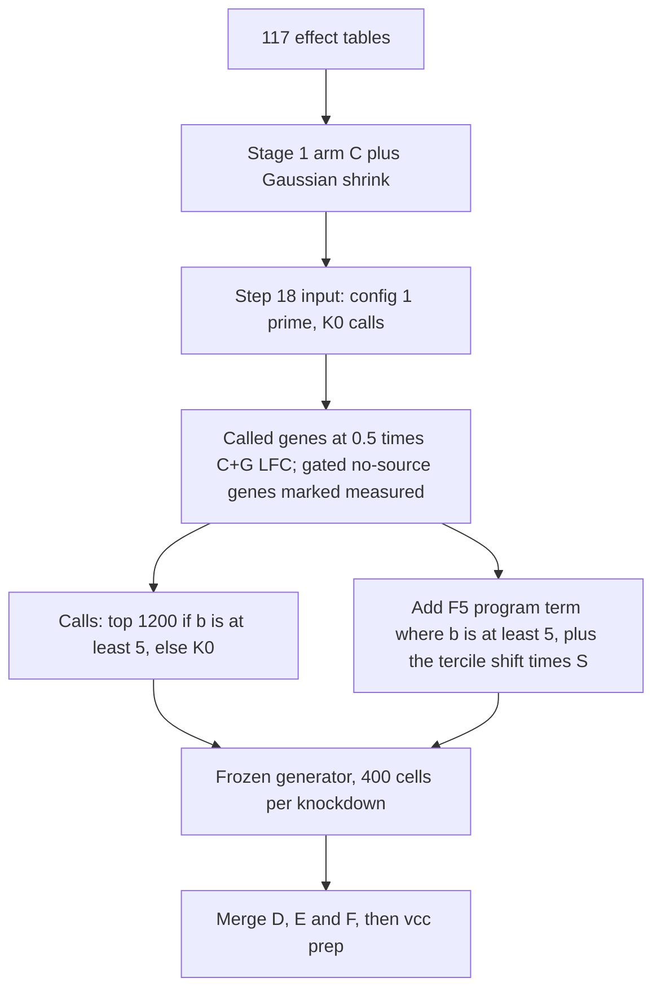

# Virtual Cell Challenge 2026

Predict, for a cell line never seen in training, how CRISPRi knockdown of each target changes expression on the 18,533-gene panel ([docs/EFFECT_TABLES.md](docs/EFFECT_TABLES.md)), and deliver 400 synthetic cells per knockdown ([docs/GENERATOR.md](docs/GENERATOR.md)). Scoring is cell-eval2 0.18.0 with the `vcc2026` profile (MSE, PDS, LFC NMAE, direction fidelity, direction reach, DE Jaccard), as used on the RPE1 dev run ([research report](results/stage1/2026-10-28_scorer_space/report.md), "RPE1 dev run"). Metric definitions and the pass rule are in [docs/EVALUATION.md](docs/EVALUATION.md). The submitted model is written up in [docs/MODEL.md](docs/MODEL.md). The public leaderboard summary is [docs/RESULTS.md](docs/RESULTS.md).

`main` is the early snapshot, from when only lines A, B and C were in hand. This branch is the discovery record through the final entry.

## 3c — Model 2, then a no-call profile

`vcc_2026_3c.ipynb` and `code/vcc_2026_3c/` are the Model 2 code: a random-effects meta-analysis on eight lines, with a top-N call rule and a detection floor ([docs/MODEL.md](docs/MODEL.md)). The leaderboard entry that scored **+0.091** (rank 749, submitted 2026-10-13) was notebook `vcc_2026_3`, top 2,000 calls, floor z = 5 ([research report](results/stage1/2026-10-28_scorer_space/report.md), section 4). That notebook is not in this tree. The copies under `code/vcc_2026_3c/` were edited after it. The extracted recipe is [results/stage1/2026-10-27_incumbent/recipe/vcc2_meta.py](results/stage1/2026-10-27_incumbent/recipe/vcc2_meta.py).

The submission made from `vcc_2026_3c` put every gene at 0.75 × Δ and made no calls. Overall **+0.070** ([docs/RESULTS.md](docs/RESULTS.md); same table in the research report). The notebook then asks whether PDS and MSE can move once the call set has stalled. `results/` and `docs/` do not record a separate overall for that study.

## 5 — transformer

`vcc_2026_5.ipynb` trains the gene-gene transformer in `code/transformer/`. PIE evidence is optional: `scripts/pie_contexts.py`, `scripts/pie_run.sh`, `scripts/pie_tables.py`, `scripts/export_pie_features.py`, with phases E–F in `scripts/phase_ef.sh` and the sweep queue in `scripts/sweep_queue.py`. The notebook is written by `scripts/make_vcc_2026_5_notebook.py`.

Submitted with every gene, a detection floor, and PIE off. Overall **+0.064**, PDS 0.214, against the Model 2 entry's +0.091 and PDS 0.416 ([docs/RESULTS.md](docs/RESULTS.md)). Held-out genes improved and the leaderboard did not. The later PIE row in that same table (v6) scored +0.057. The leaderboard row named v7 (+0.078, Δ̄ + 2(Δ − Δ̄) + floor) is that transformer series. `vcc_2026_7` below is config 1.

## 6 — stage 1 on 117 tables

`vcc_2026_6.ipynb` runs the precision-weighted transfer model (`code/vcc6/stage1.py`) on the RPE1 dev set: 300 fixed knockdowns, every RPE1 table held out. As written in that notebook the model scored **−0.20** end to end. Its slab prior multiplies effects by about 0.003. Dropping the slab and keeping Gaussian shrinkage scored **+0.122**, the first stage-1 model above the baseline ([research report](results/stage1/2026-10-28_scorer_space/report.md), "RPE1 dev run"). Arm C with that shrink was kept.

On held-out H1 cells (Eval A, official harness) the same C+G model scored **0.219**, against a port of Model 2 at 0.184, paired difference +0.034 [+0.020, +0.048] ([docs/RESULTS.md](docs/RESULTS.md)). C+G was the 28 Oct D/E/F upload.

## 7 — config 1

`vcc_2026_7.ipynb` freezes config 1. Called genes (C+G's own calls) get 0.5 × C+G's LFC. Uncalled genes get the line's control profile plus 0.5 × c × Δ_pool, with c from agreement across source lines. MSE and PDS read the pseudobulk, and about 80% of C+G's error sat on uncalled genes ([docs/MODEL.md](docs/MODEL.md)).

The noise-free proxy on Eval A (H1 held out) is overall **0.243616995654469** ([results/7/config1_record.json](results/7/config1_record.json), `evalA_H1_heldout_scaled.config1_proxy.overall`). That file records the end-to-end cell run as not done. The freeze check (cell hash, identical calls, proxy 0.24361700 both ways) is [code/vcc6/CONFIG1_FROZEN.md](code/vcc6/CONFIG1_FROZEN.md), checked by `tests/test_config1.py`.

## 8 — after the freeze, through row 4

`vcc_2026_8.ipynb` is the log of the experiments after config 1. Config 1′ raises the uncalled scale from 0.5 to 0.6. On real Eval A cells, config 1′ + K0 scored **0.243** (paired +0.024 [+0.016, +0.033] against C+G). Hybrid calls — top 1,200 tested genes where predicted strength b ≥ 5, otherwise K0 — scored **0.263**. Row 4 scored **0.2895** on Eval A (+0.047 [+0.032, +0.061] against config 1′ + K0) and 0.362 on HCT116final ([docs/RESULTS.md](docs/RESULTS.md)). The cell run is Track 1 in the [research report](results/stage1/2026-10-28_scorer_space/report.md) (Step 21; scaled overall 0.2895 [0.2695, 0.3097]) and in [results/stage1/2026-11-02_step21/tables/t1cmp.json](results/stage1/2026-11-02_step21/tables/t1cmp.json).

Generator v8 (`code/vcc6/gen_v8/`) tried ordering p-values to help direction reach. Means stayed bit-identical and 1.9% of realised call sets moved (Jaccard 0.981). It failed its check and was not used ([docs/GENERATOR.md](docs/GENERATOR.md)).

## Final submission

Row 4 is the counting entry, submitted 3 Nov ([docs/RESULTS.md](docs/RESULTS.md)). `code/vcc6/row4_def.py` builds the D/E/F generator input from Step 18's config 1′ + K0 arrays: called genes stay at 0.5 × C+G LFC, gated genes with no source are marked measured, calls are hybrid T5, and a strength shift plus the F5 program term are added in Δ before the frozen generator. `row4_gen.sh` generates the cells. `row4_final.sh` merges D, E and F and runs `vcc prep`. Eval A overall is the 0.2895 above.



## Where the rest lives

| | |
|---|---|
| Data sources | [docs/DATA_SOURCES.md](docs/DATA_SOURCES.md), `scripts/download_*`, `scripts/build_raw_cells.py` |
| Cell and perturbation QC | [docs/CELL_QC.md](docs/CELL_QC.md), `scripts/qc_replogle_umi.py`, `scripts/qc_replogle_apply.py`, `scripts/write_replogle_qc.py`, `scripts/qc_perturbations.py`, `scripts/qc_table_perturbations.py`. Per-source notes: `results/qc/<source>/qc_method.md` |
| Effect tables | [docs/EFFECT_TABLES.md](docs/EFFECT_TABLES.md), `scripts/build_effects_v5.py` |
| Generator | [docs/GENERATOR.md](docs/GENERATOR.md), `code/cellgen/cell_generator.py` |
| Scores | [docs/RESULTS.md](docs/RESULTS.md) and `results/stage1/` |

The originals of the reports that were folded into the research report on 30 Oct are in [results/archive/2026-10-30_reports_premerge/](results/archive/2026-10-30_reports_premerge/results__stage1__2026-10-27_rpe1__REPORT.md). The one-line files under `results/stage1/2026-10-27_rpe1/`, `2026-10-27_incumbent/` and `2026-10-28_DEF/` point there.

## Tests

The freeze tests expect the checkout at `~/vcc`. From a clone:

```bash
ln -sfn "$(pwd)" "$HOME/vcc"
python -m pytest tests -q
```

Dependencies are pinned in `requirements.lock` (Python 3.12). `tests/test_config1.py` checks config 1 against [code/vcc6/CONFIG1_FROZEN.md](code/vcc6/CONFIG1_FROZEN.md). `tests/test_cellgen.py` checks the frozen generator. `tests/test_transformer.py` skips unless `lib/effects_v4/` is present. `lib/`, `data/` and `*.h5ad` are gitignored, so tests that read those files fail on a fresh clone.
