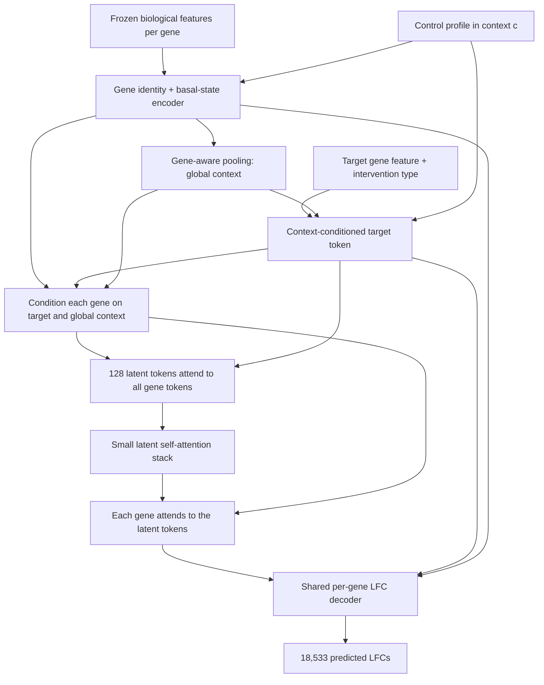

# Draft: basal-conditioned gene attention for perturbation effects

This is an architecture proposal, not a trained model or a claim of validated performance. It takes a target gene and controls from a new cellular context and predicts one population-level effect per readout gene. The proposed first model uses PIE's published biological input features, learned expression conditioning, and attention through a small set of latent tokens.

## What to reuse from PIE

PIE is a complete response predictor, not simply a gene embedding lookup. Its public inputs include gene-description embeddings (`gene_text`), protein-sequence embeddings (`esm2`), and protein-network embeddings (`string_space`). The published dimensions are 3,072, 1,280, and 512 respectively. Their gene coverage differs; coverage must be checked against our IDs. Downloading these features does not require running a PIE checkpoint. [PIE sources](https://huggingface.co/datasets/arcinstitute/PIE_sources)

Start with frozen `gene_text` vectors for all available genes and train a small projection. Add STRING or ESM-2 only as evaluated extensions. Sequence features do not cover noncoding genes. Use reviewed symbol/Ensembl mappings, source-availability masks, and an explicit fallback for missing features. Do not manufacture matches by dropping suffixes from ambiguous duplicated symbols.

If we specifically want representations learned by PIE, its `gene_query_mlp` projects gene-description vectors into its learned query space. That is a possible transfer initialization. Its later decoded features depend on the perturbation, controls, and response evidence, so those are conditional features rather than a single permanent vector per gene. [PIE model implementation](https://github.com/ArcInstitute/pie/blob/main/src/pie/model/pie.py)

The full checkpoint is another baseline, with different preprocessing and evidence requirements. The published within-Replogle experiment has a 6,642-gene measured axis; reproducing it is not automatically equivalent to modeling our 18,533 outputs. [PIE within-dataset model card](https://huggingface.co/arcinstitute/PIE_replogle_wdataset)

The notebook calls H1 the validation line. PIE's cross-dataset checkpoint trained on ARC VCC 25, among other datasets; using those learned weights would compromise an H1 response-label holdout. Audit the entire pretraining history for each claimed held-out context or perturbation. Frozen biological source features avoid importing PIE's fitted perturbation-response parameters, although their provenance should still be recorded. [PIE cross-dataset model card](https://huggingface.co/arcinstitute/PIE_replogle_xdataset)

Embedding coordinates encode distributed information; an individual coordinate need not correspond to a named pathway. Random initialization of the attention projections is normal: training learns how to use the biological features.

## Data contract and prediction scale

The following repository facts were checked when drafting:

- `data/gene_names.csv` contains 18,533 distinct gene symbols. Preserve this output ordering.
- `data/pert_counts.csv` contains 300 distinct challenge targets, all in that readout axis. The quoted 575 is treated here as an intended training-panel size, not a verified number of QC-passing targets.
- `vcc_2026_4.ipynb` retains each source's measured gene vocabulary until alignment. An absent gene is unmeasured, not a measured zero.
- `scripts/build_effect_tables.py` defines `lfc` as log2 fold change of mean per-cell CPM, with a 0.5-CPM pseudocount. It also computes an SE. Its output directory was not present during inspection, so these are the script's intended outputs, not verified generated tables.
- `code/vcc_context_profile_v3.py` uses ratio-of-sums CPM for its legacy transfer baseline. That differs from mean per-cell CPM. It also retains the latter; verify library denominators before reusing any profile.

For context c, target t, and readout gene i, define:

    b[c,i] = mean CPM across QC-passing non-targeting control cells
    mu[c,t,i] = mean CPM across QC-passing cells with target t knocked down
    r[c,t,i] = log2((mu[c,t,i] + 0.5) / (b[c,i] + 0.5))

The primary model output is r_hat, an LFC vector. If an additive CPM delta is required:

    mu_hat[c,t,i] = max(0, (b[c,i] + 0.5) * 2**r_hat[c,t,i] - 0.5)
    delta_cpm_hat[c,t,i] = mu_hat[c,t,i] - b[c,i]

Do not add an LFC directly to a CPM baseline. Mean log1p expression, log1p mean CPM, and log2 fold change of mean CPM are also distinct quantities.

Use one documented normalization/library-denominator convention across contexts. Do not renormalize a released subset of genes as if it were the full library. Keep source-appropriate full library totals where available and audit remaining differences. Match controls by condition, time, and experimental batch where the design permits; assess residual batch confounding. Basal measurements cannot reveal every unobserved genotype or protein state.

Maintain separate masks for measured controls, biological-source availability, and valid effect labels. Never fill missing effect labels with zero. Keep measured, low-baseline genes eligible for induction predictions.

## Shape of the problem

For P requested knockdowns, G readout genes, and feature width d:

| Object | Shape | Meaning |
| --- | --- | --- |
| Shared static identity features | U x d | U is the union of readout and target genes |
| Readout feature lookup | G x d | G = 18,533 |
| Target feature lookup | P x d | e.g. P = 575 if that is the chosen panel |
| Basal profile | G | One context's mean control CPM |
| Conditional hidden states | B x G x d | B sampled context-target pairs |
| Prediction | B x G | One LFC per gene for each pair |
| All requested predictions in one context | P x G | The effect table, not an embedding table |

Predicting all G readouts for trained targets and predicting new knockdown targets are different tasks. Observing a gene as a readout does not establish what happens when that gene is knocked down. Shared biological features permit an unseen-target prediction, but its accuracy requires a separate target holdout experiment.

## Architecture

This is a proposed model inspired by attention through a latent bottleneck; it is not a description of PIE's exact architecture. Gene-to-gene communication is mediated by the latents rather than an explicit all-pairs gene attention matrix.

### 1. Encode biological identity

Let z_i be the frozen gene-description vector and e_i its learned d-dimensional projection:

    e_i = Project_text(Normalize(z_i))

For the multi-source extension, separately normalize/project each available source, concatenate the results and availability bits, then fuse with a shared MLP. Avoid a trainable ID-only lookup as the sole identity representation: an unseen target would have no trained identity vector.

### 2. Encode basal state locally and globally

The minimum expression feature is log1p(b[c,i]). Optional control-only features are detection fraction and log1p variance of per-cell CPM. Include a measured-gene indicator and mask unavailable features.

    u[c,i] = ExprMLP([log1p(b[c,i]), optional_control_features, masks])
    h[c,i] = LayerNorm(GeneMLP(concat(e_i, u[c,i])))
    a[c,i] = softmax_i(w_pool^T tanh(W_pool h[c,i]))
    g[c] = sum_i a[c,i] * h[c,i]

Pool over observed controls only. This pooling retains gene identity; an unweighted average of expression values alone would discard it. No cell-line ID lookup is necessary for a new context. Standardization parameters, if used, are fitted on training contexts only.

Keep expression as an encoded feature rather than using e_i * b[c,i] as the only representation: a measured zero should not erase the gene's identity or prevent its induction.

### 3. Encode the intervention and condition every gene

    p[c,t] = TargetMLP(concat(e_t, u[c,t], g[c], intervention_type))
    (gamma[c,t], beta[c,t]) = ConditionMLP(concat(p[c,t], g[c]))
    x[c,t,i] = LayerNorm((1 + gamma[c,t]) * h[c,i]
                         + beta[c,t]
                         + is_target(i,t) * v_target)

The products are elementwise. The `is_target` marker is shared across genes; it does not allocate one parameter per target. Include the target token even if t is outside the readout axis. In that case, obtain its basal features from the source's wider gene vocabulary when possible, otherwise mark them unavailable.

Do not overwrite b[c,t] with zero. The baseline describes the untreated context; the intervention is a separate input. Measured knockdown efficiency from the perturbed cells is unavailable at deployment and must not be an inference feature. A prescribed dose or efficiency estimate is permissible only if it can actually be supplied or predicted independently at inference; begin with an intervention-type input alone.

### 4. Mix gene information using a bounded number of latent tokens

For learned latent tokens L0 of shape M x d and all conditioned gene tokens X:

    L = CrossAttention(Q=L0, K=concat(X, p), V=concat(X, p))
    L = LatentTransformer(L)
    H_out = X + CrossAttention(Q=X, K=L, V=L)

Use normal transformer residual paths, normalization and feed-forward layers around these schematic attention operations. Mask gene keys with unavailable control measurements while retaining a target token with explicit availability bits. Readout queries can still be decoded when a source lacked that gene; their training losses must be masked when no label exists.

For example, the gene-to-latent attention weights are:

    A[m,i] = softmax_i((Wq L0[m])^T (Wk x[c,t,i]) / sqrt(d_head))

Both the keys and the values contain the gene's basal features and target conditioning. Thus the information pooled from a gene changes with the control profile and intervention. Each readout gene then retrieves different mixtures from the latent representation. This is how genes communicate through the intermediate tokens.

Start with d=128, M=128, four heads, two latent transformer layers, one encoder cross-attention block, one decoder cross-attention block, and dropout 0.1. These are starting hyperparameters, not established optima. Use small context-target minibatches, subject to available GPU memory.

Full gene self-attention has 18,533^2 = 343,472,089 scores per head and sample. One G x 128 attention map has 2,372,224 scores. The proposed encoder and decoder each have such a map, with a much smaller M x M latent self-attention cost; this is not a claim about total model memory. Attention kernels can reduce stored activations without eliminating dense all-pairs computation.

If direct gene-to-gene edges are a later requirement, substitute sparse attention over selected gene neighbors, retaining global/target access. STRING may provide candidate neighbors or a soft bias, but its associations are not directed regulatory ground truth. Test this extension rather than assuming it improves transfer.

### 5. Decode one effect per gene with shared weights

    r_hat[c,t,i] = ReadoutMLP(concat(H_out[c,t,i], h[c,i], p[c,t],
                                   h[c,i] * p[c,t], u[c,i]))

The same decoder is applied to every gene and target. Including the local basal feature again gives the readout a direct route to use expression, while the attention blocks handle global interactions. The decoder produces signed effects; attention weights themselves are neither signed effects nor evidence of causal regulation.

Avoid a design in which every readout query attends to only one target key: softmax over a single key is always one. The target still needs an explicit pairwise decoder or feature modulation, and gene information needs multiple keys or another mixing mechanism.

## Training and evaluation

Use QC-passing context-target effect rows from the source tables, with the matching control profile. The current effect-table builder does not save the computed control mean/variance arrays; a future data-preparation step must persist them or recompute them from precisely the same controls and denominators. Preserve every label's gene/target IDs and provenance.

Begin with a masked, uncertainty-weighted Huber loss on LFC:

    weight[c,t,i] = min(w_max, 1 / (se[c,t,i]^2 + tau^2))
    loss[c,t] = sum_valid_i weight[c,t,i] * Huber(r_hat[c,t,i] - r[c,t,i])
                / sum_valid_i weight[c,t,i]
    loss = mean_over_sampled_context_target_pairs(loss[c,t])

Exclude pairs without valid labels. Select tau and the cap on training/development data so near-zero SEs cannot dominate. Balance contexts in sampling; a large screen should not determine the entire fit. The gene labels in one response vector are correlated, so P x G labels are not P x G independent perturbation experiments.

Resample or bootstrap only the controls permitted for each training example when augmenting context profiles. Distinguish technical resampling from independent biological replication. Begin with frozen source embeddings; learn the projections, expression encoders, attention and decoder. Auxiliary DE classification is optional only if consistent DE labels exist; SE is not itself a DE label.

Use three distinct generalization tests:

| Split | What is withheld | What it tests |
| --- | --- | --- |
| Context holdout | All perturbation responses in one cell line; its controls are permitted | Transfer to a new line |
| Target holdout | All responses to selected targets across every training context | New knockdown identities |
| Joint holdout | Both the line and target sets | The complete proposed use case |

Group guides for a target together. Do not randomly split cells from the same context-target pair across train and test. Keep closely related conditions/datasets grouped where required by the claim. If H1 is repeatedly used to select hyperparameters, call it development/validation and reserve another untouched evaluation fold; do not present H1 as an untouched final test.

Compare at minimum:

1. No change: r_hat=0.
2. Existing context-independent effect transfer for targets with training evidence.
3. A small shared pairwise MLP using concat(e_i, e_t, e_i*e_t, u[c,i], u[c,t], g[c]), without attention.
4. The proposed attention model.

For unseen targets, include a biological-embedding nearest-neighbor or regularized regression baseline instead of assuming the same-target transfer baseline is available. Use all available training screens that survive consistent QC rather than unnecessarily restricting to the challenge's requested targets; preserve the target holdouts.

Ablate basal inputs, then biological features, then attention. Evaluate the basal ablation across the whole model, including the context and target encoders; removing only one expression path is not an ablation of context. A control-profile swap can be a sensitivity diagnostic, but is not on its own proof of correct biological conditioning.

Report per-context and per-target LFC error and correlation, with and without the perturbed gene. Use held-out truth to report changed-gene subsets under a prespecified rule; do not choose metrics or filters after inspecting the final test. Add DE ranking metrics only with valid DE labels. Report performance and embedding coverage separately for seen/unseen targets and measured/unmeasured output genes. If an output gene has never had a training label, mark that extrapolation explicitly.

Basal controls are useful deployment inputs, but many controls from one line do not replace response data from diverse lines. Control means also cannot identify every biological state with the same transcriptome. This model predicts population means/effects; generating realistic single-cell distributions would require a separate, validated component.

## Suggested implementation order

1. Finalize response-label QC and save aligned control statistics, masks, LFCs, SEs and source metadata. Freeze the evaluation splits first.
2. Fetch only `gene_text` metadata and embeddings from PIE sources at a pinned revision; audit coverage for the union of target and readout genes and save the mapping.
3. Fit the shared pairwise MLP baseline with those frozen features and basal inputs.
4. Add the latent attention blocks without changing the data contract or evaluation splits.
5. Retain extra sources, larger models or pretrained PIE projections only when held-out experiments support them.

The intended delivered prediction is an ID-aligned target-by-gene LFC table for each requested context, with the transformation to an additive CPM delta made explicit. No model weights, large source files or training jobs were created as part of this draft.
